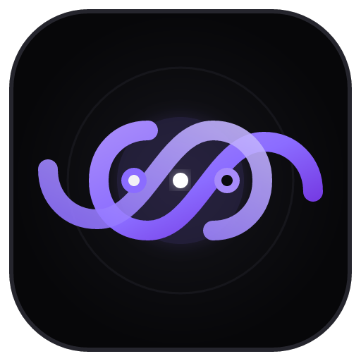
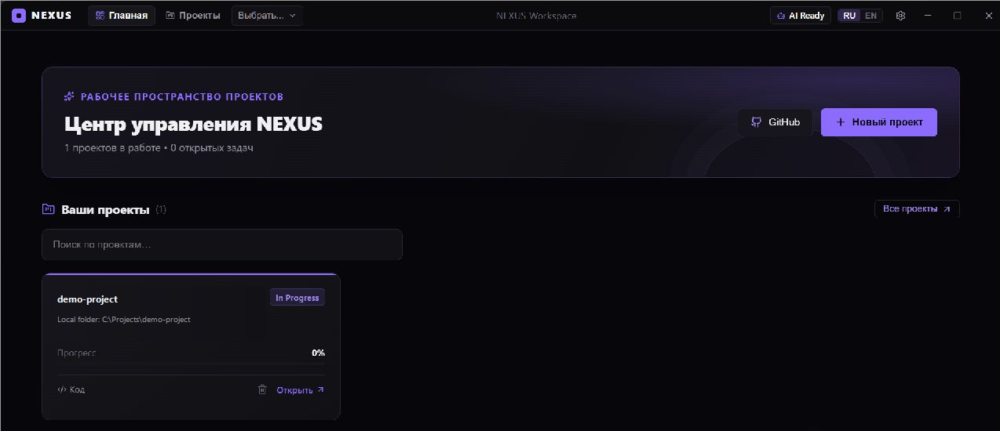
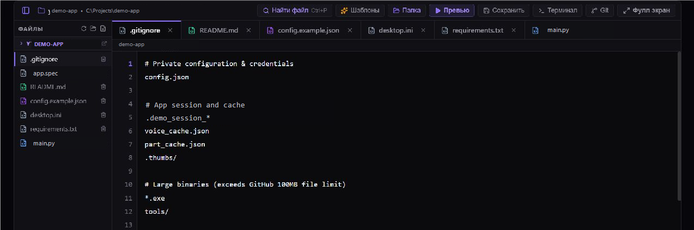
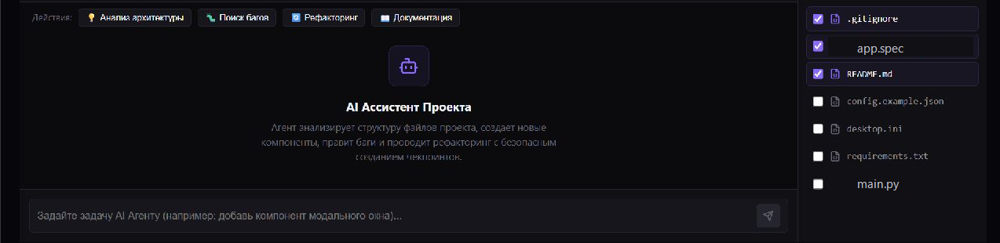
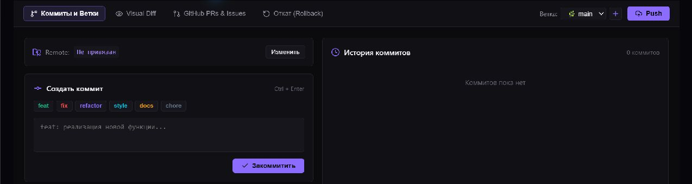
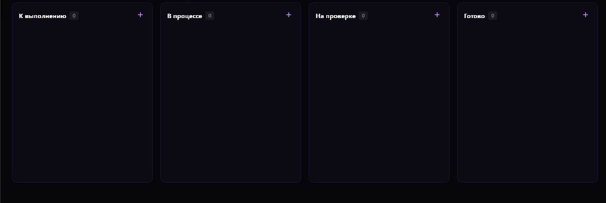

# NEXUS — Minimal Dark AI-Powered IDE & Project Environment

<div align="center">
  
  <p><strong>Современная профессиональная среда разработки и управления проектами с автономным AI-агентом</strong></p>
  <p><em>Modern, minimalist, high-performance project studio and AI-assisted workspace built with Tauri 2, Rust, and React 19.</em></p>
  <br/>

  <a href="https://github.com/yto4ka002/nexus/releases/download/v1.0.0/NEXUS.exe">
    
  </a>
  &nbsp;
  <a href="https://github.com/yto4ka002/nexus/releases/download/v1.0.0/NEXUS_Setup.exe">
    
  </a>
  <p><sub>⚡ Не требует установки: просто скачайте <code>NEXUS.exe</code> и запускайте сразу на Windows 11.</sub></p>
</div>

## Screenshots

<p><em>Названия проектов и локальные пути на скриншотах заменены демонстрационными значениями. / Project names and local paths are anonymized.</em></p>

<table>
  <tr>
    <td width="50%"></td>
    <td width="50%"></td>
  </tr>
  <tr>
    <td align="center"><sub>Главная панель проектов / Project dashboard</sub></td>
    <td align="center"><sub>Редактор кода и файловые вкладки / Code editor and file tabs</sub></td>
  </tr>
  <tr>
    <td width="50%"></td>
    <td width="50%"></td>
  </tr>
  <tr>
    <td align="center"><sub>AI-агент и контекст проекта / AI Agent and project context</sub></td>
    <td align="center"><sub>Git, коммиты и история / Git, commits, and history</sub></td>
  </tr>
  <tr>
    <td colspan="2"></td>
  </tr>
  <tr>
    <td colspan="2" align="center"><sub>Kanban-доска: планирование и этапы задач / Kanban board for planning and task stages</sub></td>
  </tr>
</table>

---

## Содержание / Table of Contents
- [Screenshots](#screenshots)
- [Русская версия (Russian)](#-русская-версия)
  - [Обзор](#обзор)
  - [Ключевые возможности](#ключевые-возможности)
  - [Дизайн и визуальная концепция](#дизайн-и-визуальная-концепция)
  - [Стек технологий](#стек-технологий)
  - [Установка и запуск](#установка-и-запуск)
  - [Сборка инсталлятора](#сборка-инсталлятора)
- [English Version](#-english-version)
  - [Overview](#overview)
  - [Key Features](#key-features)
  - [Design Philosophy](#design-philosophy)
  - [Tech Stack](#tech-stack)
  - [Getting Started](#getting-started)
  - [Building Release & Installer](#building-release--installer)
- [Подробное техническое описание (Russian)](#-подробное-техническое-описание-архитектуры)
- [In-Depth Technical Architecture (English)](#-in-depth-technical-architecture)

---

# 🇷🇺 Русская версия

## Обзор

**NEXUS** — это специализированная среда разработки и управления проектами под Windows 11. Программа объединяет файловый менеджер, подсветку синтаксиса, встроенный терминал, систему контроля версий Git, просмотр Diff и задач с автономным AI-агентом, умеющим анализировать архитектуру, находить ошибки, генерировать код и безопасно применять изменения с созданием чекпоинтов.

В версии **NEXUS 1.1** полностью удалены все перегружающие интерфейс элементы (погода, музыка, автоматизация, буфер обмена). Приложение сфокусировано исключительно на разработке и продуктивности.

---

## Ключевые возможности

### 1. Projects (Управление проектами)
- Создание и переключение между изолированными рабочими пространствами.
- Привязка локальных каталогов (`repo_path`) и удаленных репозиториев (`git_remote`).
- Индивидуальные параметры каждого проекта, отслеживание прогресса выполнения задач и дедлайнов.

### 2. File Manager & Code Studio (Редактор кода)
- Иерархическое дерево каталогов и файлов проекта.
- Создание, переименование, редактирование и удаление файлов любого типа (`.ts`, `.tsx`, `.rs`, `.py`, `.json`, `.md` и др.).
- Быстрое переключение файлов по вкладкам с сохранением состояния.

### 3. Git & Visual Diff (Контроль версий)
- Отслеживание изменений в рабочей директории в реальном времени.
- **Построчный Visual Diff**: наглядное сравнение исходного файла и предложенных изменений с цветовой индикацией (`+` зелёный, `-` красный, `@@` фиолетовый).
- Создание коммитов с поддержкой Conventional Commits (`feat`, `fix`, `refactor`, `style`, `docs`, `chore`).
- Управление ветками (создание, переключение, push на удалённый репозиторий).
- История коммитов с возможностью отката в один клик.

### 4. GitHub Integration (Прямая интеграция)
- Прямая работа с GitHub API через безопасные токены.
- Просмотр списка открытых и закрытых **Pull Requests** и **Issues**.
- Быстрый переход в веб-интерфейс GitHub к конкретным PR и задачам.

### 5. Multi-Provider AI (Мультипровайдерный ИИ)
- Поддержка широкого спектра провайдеров:
  - **OpenAI** (`gpt-4o`, `gpt-4o-mini`, `o1-mini` и др.)
  - **Anthropic Claude** (`claude-3-5-sonnet-20241022`, `claude-3-haiku`)
  - **Google Gemini** (`gemini-1.5-pro`, `gemini-1.5-flash`)
  - **Ollama (локальный / офлайн)** (`llama3`, `mistral`, `deepseek-coder`, `qwen2.5-coder` по адресу `http://localhost:11434`)
  - **Custom OpenAI-compatible** (Groq, Together AI, vLLM, LocalAI)
- Встроенная проверка соединения (Test Connection) в модальном окне настроек.

### 6. AI Agent (Автономный инженер)
- Автономный ассистент, глубоко интегрированный с исходным кодом проекта.
- Готовые сценарии: **Анализ архитектуры**, **Генерация фич**, **Поиск багов**, **Рефакторинг**, **Генерация документации**.
- Парсер блоков кода: агент автоматически выделяет файлы, для которых предложены правки.
- Интерактивный предпросмотр Diff перед применением изменений к файлам проекта.

### 7. AI Context (Индивидуальный контекст проекта)
- Индивидуальные параметры архитектуры, используемого стека технологий (`React 19`, `Tauri 2`, `Rust`, `FastAPI` и т.д.).
- Соглашения по оформлению кода и стандарты разработки.
- Файл правил `.nexus/rules.md`, автоматически внедряемый в каждый системный промпт модели.

### 8. AI Permissions (Безопасность и права доступа)
- Трёхуровневая система прав доступа:
  - **Редактирование файлов**: `Разрешено` / `С подтверждением` / `Запрещено`
  - **Создание и удаление файлов**: `Разрешено` / `С подтверждением` / `Запрещено`
  - **Выполнение команд в терминале**: `Разрешено` / `С подтверждением` / `Запрещено`

### 9. Embedded Terminal (Встроенный терминал)
- Интерактивный терминал PowerShell, открывающийся непосредственно в корне проекта.
- Быстрые пресеты команд (`npm run build`, `cargo check`, `git status`, `dir`).
- История выполнения команд, фиксация времени выполнения в миллисекундах и кодов выхода.

### 10. Tasks & Kanban (Задачи и чеклисты)
- Полноценная Kanban-доска с колонками `To Do`, `In Progress`, `Review`, `Done`.
- Проектный чеклист с отметкой выполненных задач и динамическим пересчетом процента готовности.

### 11. Technical Documentation (Документация Markdown)
- Двухоконный редактор технической документации со Split-режимом и мгновенным предпросмотром Markdown.
- Кнопки автоматической генерации с помощью AI: `README.md`, `ARCHITECTURE.md`, `API.md`.

### 12. Activity Log (Журнал активности)
- Хронологическая лента аудита всех действий: изменения файлов, Git-коммиты, Push, ответы AI, создание чекпоинтов и запуск терминала.
- Быстрая фильтрация по категориям событий.

### 13. Safety Checkpoints (Чекпоинты и снимки)
- Мгновенное сохранение полного снимка всех файлов проекта в SQLite базу данных.
- Автоматическое создание снимка безопасности перед любыми крупными изменениями кода через AI Agent.
- Безопасное восстановление исходного состояния проекта в 1 клик.

### 14. Project Templates (Шаблоны проектов)
- Быстрое развертывание типовых структур в 1 клик:
  - **React 19 + TypeScript + Vite + Tailwind CSS**
  - **Node.js Fastify / Express REST API**
  - **Python FastAPI Backend**
  - **Rust CLI Application (clap + serde)**
  - **Minimal Modern Web (HTML5/CSS3/ES6)**

---

## Дизайн и визуальная концепция

Интерфейс NEXUS спроектирован по канонам **Minimal Dark UI**:
- Стандартная строка заголовка Windows полностью скрыта (`"decorations": false`).
- Реализован кастомный **Obsidian-style Titlebar** с нативным перетаскиванием окна (`data-tauri-drag-region`) и плавными кнопками управления окном.
- **Цветовая палитра**:
  - Основной фон: `#0B0B0E`
  - Поверхности карточек: `#111115`
  - Панели и вкладки: `#16161C`
  - Границы: `#25252D`
  - Основной текст: `#F1F1F5`
  - Второстепенный текст: `#92929F`
  - Фиолетовый акцент: `#8B6CFF` и `#A78BFA`

---

## Стек технологий

- **Десктопное ядро**: [Tauri 2.0](https://tauri.app/) (Rust)
- **База данных**: SQLite (локальное хранилище без внешних зависимостей)
- **Фронтенд**: React 19, TypeScript, Vite
- **Иконки**: Lucide React
- **Сборка установщика**: NSIS (Nullsoft Scriptable Install System)

---

## Установка и запуск

### Требования
- Node.js 20+ и npm
- Rust toolchain (`rustc`, `cargo`)
- MinGW-w64 / MSVC линкер

### Запуск в режиме разработки
```bash
# Установка зависимостей фронтенда
npm install

# Запуск приложения в dev-режиме (Vite + Tauri)
npm run tauri dev
```

### Сборка релиза
```bash
# Компиляция оптимизированного фронтенда
npm run build

# Сборка готового бинарного файла и установщика Windows (NSIS)
npx @tauri-apps/cli build --bundles nsis
```
После сборки готовые файлы будут находиться в папках:
- Портативный исполняемый файл: `src-tauri/target/release/nexus.exe`
- Установщик Windows: `src-tauri/target/release/bundle/nsis/NEXUS_1.0.0_x64-setup.exe`

---
---

# 🇬🇧 English Version

## Overview

**NEXUS** is an ultra-minimalist, AI-powered desktop development environment and project manager built for Windows 11. It unifies project files, code editing, integrated terminal execution, Git version control, visual diffs, Kanban development tasks, and autonomous AI code assistance with safety checkpoints.

In **NEXUS 1.1**, secondary desktop utilities (weather, music players, download widgets, automations) were eliminated to deliver a laser-focused, distraction-free environment tailored exclusively for professional software development.

---

## Key Features

1. **Projects**: Multi-workspace organization, local repository binding (`repo_path`), project metadata, and deadline tracking.
2. **File Manager & Code Studio**: Multi-tab code editor with project file trees, language detection, and file management.
3. **Git & Visual Diff**: Real-time git status tracking, line-by-line Diff viewer with syntax coloring, Conventional Commits helper, branch management, and commit log rollback.
4. **GitHub Integration**: Direct GitHub REST API connection for Pull Requests and Issues inspection with one-click navigation to GitHub.
5. **Multi-Provider AI**: Connect OpenAI, Anthropic Claude, Google Gemini, Local Ollama (`http://localhost:11434`), and custom OpenAI-compatible endpoints with live latency testing.
6. **AI Agent**: Project-aware code engineer capable of architectural audits, automated bug-fixing, refactoring, and code generation with pre-apply Diff preview.
7. **AI Context**: Project-level guidelines, tech stack tags, and `.nexus/rules.md` injected directly into model system prompts.
8. **AI Permissions**: Granular security policies for file edits, file creation/deletion, and terminal command execution (`Allow`, `Ask Confirm`, `Deny`).
9. **Embedded Terminal**: Native PowerShell terminal launched in the project workspace with command presets, history, duration tracking, and exit codes.
10. **Tasks & Kanban**: Interactive Kanban board (`To Do`, `In Progress`, `Review`, `Done`) and project task checklists with automatic progress percentage calculation.
11. **Technical Documentation**: Dual-pane Markdown editor with live preview and AI generator for `README.md`, `ARCHITECTURE.md`, and `API.md`.
12. **Activity Timeline**: Complete chronological audit log of file modifications, git commits, AI interactions, checkpoints, and terminal commands.
13. **Safety Checkpoints**: Instant snapshots of all project files saved into SQLite, created automatically prior to AI code modifications for risk-free 1-click restore.
14. **Project Templates**: Instant project scaffolds for React 19 + TypeScript + Vite, Node.js API, Python FastAPI, Rust CLI, and Vanilla Modern Web.

---

## Design Philosophy

- **Frameless Obsidian-Style Titlebar**: Native OS window borders removed (`"decorations": false`), replaced with a sleek integrated header supporting native OS dragging (`data-tauri-drag-region`) and minimalist window control actions.
- **Palette**:
  - Base Background: `#0B0B0E`
  - Surface Background: `#111115`
  - Panel Background: `#16161C`
  - Border Lines: `#25252D`
  - Primary Text: `#F1F1F5`
  - Muted Text: `#92929F`
  - Violet Accents: `#8B6CFF` / `#A78BFA`

---

## Tech Stack

- **Core / Backend**: [Tauri 2.0](https://tauri.app/) (Rust)
- **Database**: SQLite (embedded local persistence)
- **UI Framework**: React 19, TypeScript, Vite
- **Icons**: Lucide React
- **Packaging**: NSIS Windows Installer

---

## Getting Started

### Prerequisites
- Node.js 20+ and npm
- Rust toolchain (`rustc`, `cargo`)
- MinGW-w64 or MSVC compiler toolchain

### Development Mode
```bash
npm install
npm run tauri dev
```

### Building Release Packages
```bash
npm run build
npx @tauri-apps/cli build --bundles nsis
```
Built binaries:
- Portable executable: `src-tauri/target/release/nexus.exe`
- Installer: `src-tauri/target/release/bundle/nsis/NEXUS_1.0.0_x64-setup.exe`

---
---

# 🔬 Подробное техническое описание архитектуры

### Взаимодействие Frontend и Rust Backend (Tauri 2 IPC)
Фронтенд на React 19 взаимодействует с ядром на Rust через типизированные IPC-команды `invoke('command_name', args)`. В файле `src-tauri/src/commands.rs` реализованы:
- Управление окном без стандартной рамки Windows: `window_minimize_cmd`, `window_toggle_maximize_cmd`, `window_close_cmd` с прямым доступом к `tauri::WebviewWindow`.
- Встроенный терминал: команда `run_project_terminal_cmd` запускает процесс `powershell.exe` с аргументами `-NoProfile -NonInteractive -Command ...` в рабочем каталоге проекта, замеряет длительность выполнения через `std::time::Instant` и возвращает структурированный результат (`stdout`, `stderr`, `exit_code`, `duration_ms`).
- Git & Diff: команда `git_diff_cmd` выполняет нативный `git diff` с возвратом унифицированного патча. При отсутствии установленного Git возвращается понятное предупреждение, не блокирующее работу приложения.
- Чекпоинты и безопасность: команды `create_checkpoint_cmd`, `list_checkpoints_cmd`, `restore_checkpoint_cmd` оперируют таблицей `project_checkpoints` в SQLite, сжимая и сохраняя состояние массива файлов.
- AI Мультипровайдер: команда `ai_chat_cmd` использует асинхронный HTTP-клиент `reqwest` для отправки стандартизированных запросов к API OpenAI, Anthropic, Gemini, Ollama и кастомных эндпоинтов.

### База данных SQLite
Файл `nexus.db` создается локально в каталоге приложения. Схема базы данных инициализируется в `src-tauri/src/db.rs` и включает таблицы:
- `projects`: хранение метаданных, путей к репозиториям, снимков файлов в JSON, контекста AI и разрешений безопасности.
- `tasks`: задачи Kanban и проектных списков с приоритетами и статусами.
- `project_checkpoints`: моментальные снимки файлов для безопасного отката.
- `activity_logs`: журнал событий аудита.
- `settings`: глобальные настройки приложения (выбранная тема, активный AI провайдер, API ключи).

---

# 🔬 In-Depth Technical Architecture

### IPC Command Dispatch & Execution Engine
NEXUS leverages Tauri 2's high-speed binary bridge for zero-latency inter-process communication between the React 19 interface and the Rust core:
- **Frameless Window Management**: Native window frame is disabled via `decorations: false`. Dragging is delegated to HTML elements tagged with `data-tauri-drag-region`, while minimize, maximize/unmaximize, and close actions invoke `window_minimize_cmd`, `window_toggle_maximize_cmd`, and `window_close_cmd` directly on the Rust `WebviewWindow` handle.
- **Embedded Terminal Process Isolation**: `run_project_terminal_cmd` spawns an asynchronous PowerShell subprocess in the active project's root folder, enforcing timeout safeguards, capturing standard output and error streams separately, and recording execution elapsed time down to milliseconds.
- **Visual Diff Calculation**: `git_diff_cmd` inspects working tree changes against HEAD using git plumbing/porcelain calls, formatting unified diff outputs with colored lines for clear side-by-side comparison.
- **Snapshot Storage & Revert**: `project_checkpoints` stores raw file contents as versioned snapshots, allowing instant atomic rollback without disk contamination.
- **Unified Multi-LLM API Bridge**: `ai_chat_cmd` normalizes request envelopes across OpenAI-compatible REST formats, Anthropic's Messages API, and Gemini's REST protocol, supporting custom endpoints and local offline inference via Ollama.

### Local SQLite Storage Architecture
All project states, tasks, and audit traces persist in a local SQLite database (`nexus.db`):
- Relational integrity ensures tasks and checkpoints are strongly tied to their parent `projects`.
- Settings and AI configurations are safely persisted across restarts without external cloud dependencies.
- Activity streams automatically log every significant action (file save, git commit, AI generation, terminal execution) ensuring full traceability.
